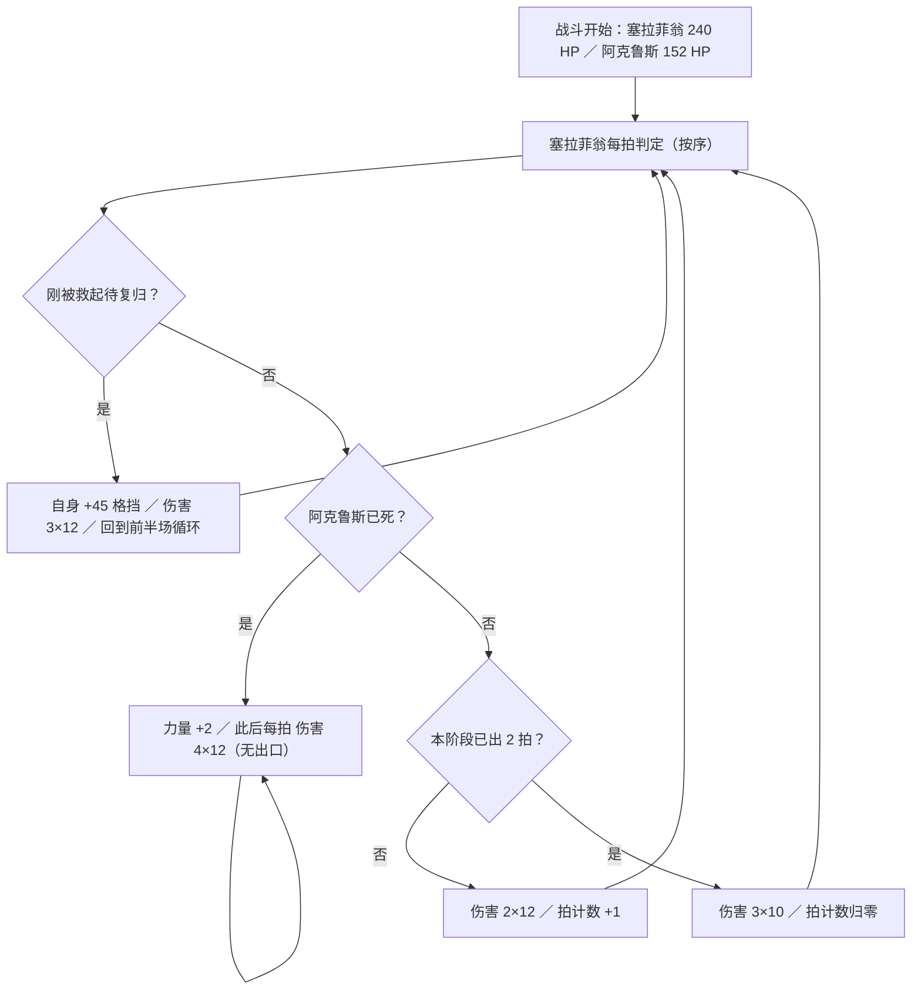
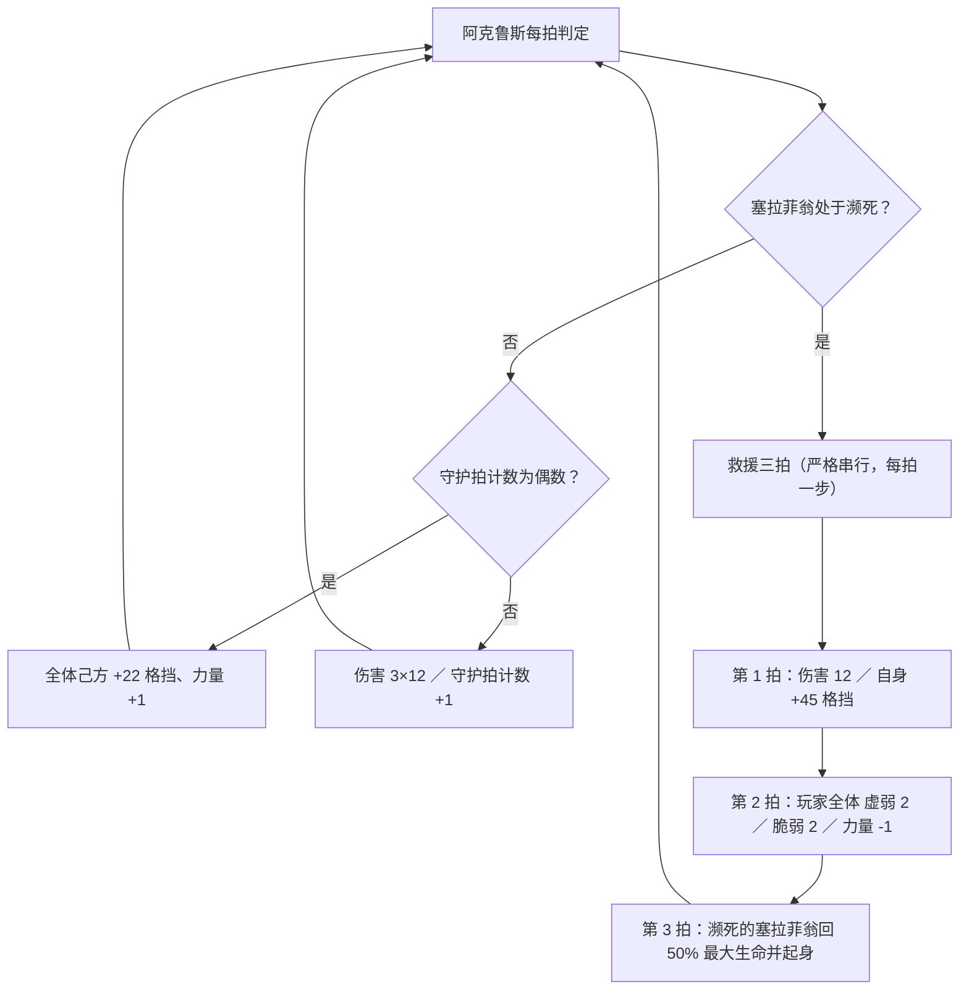
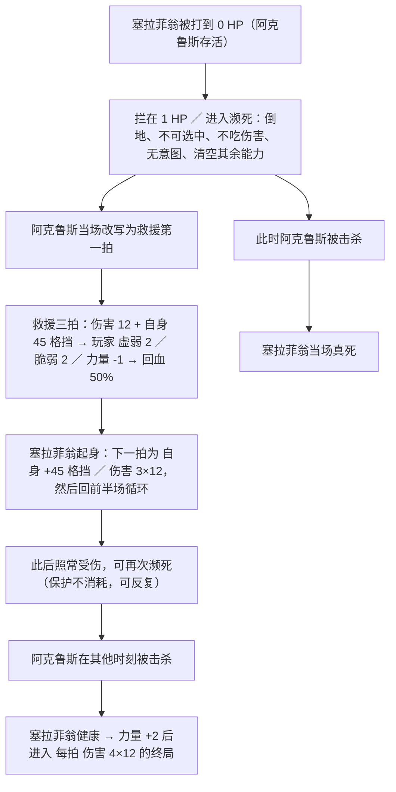
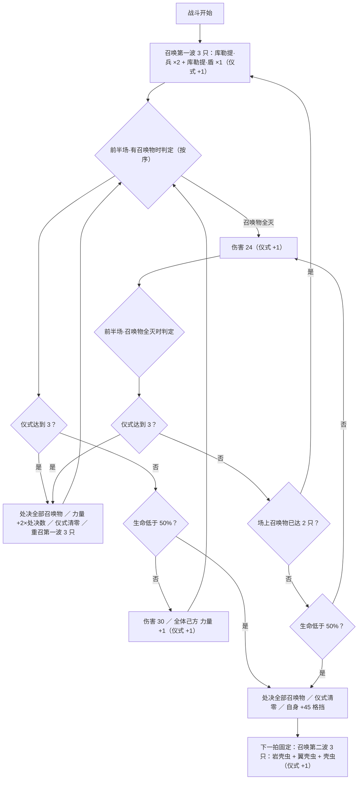
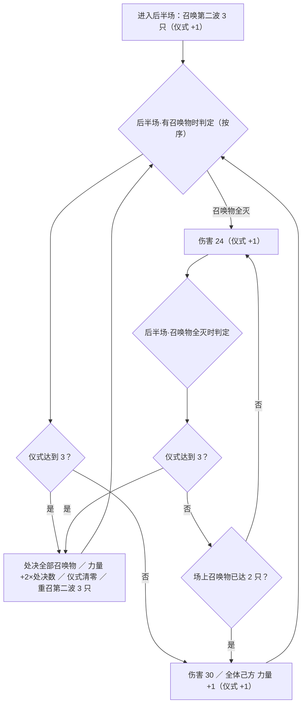
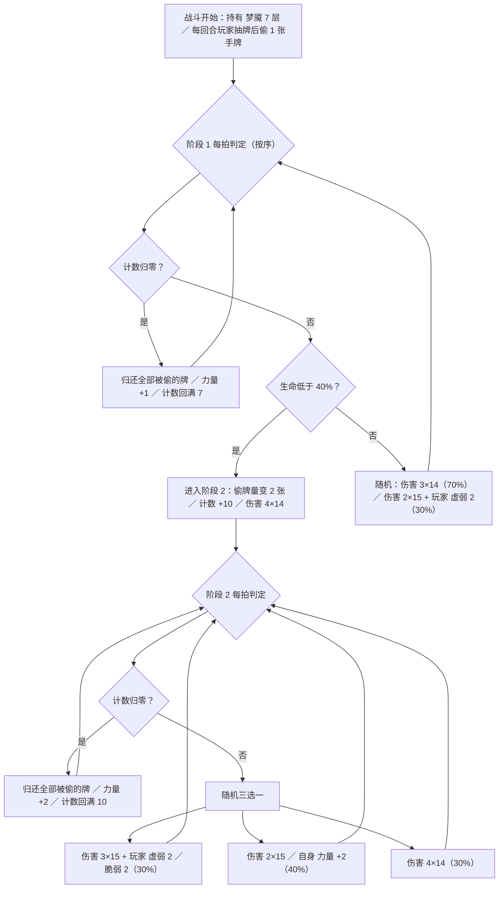
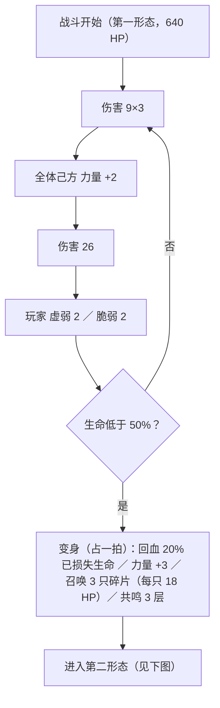
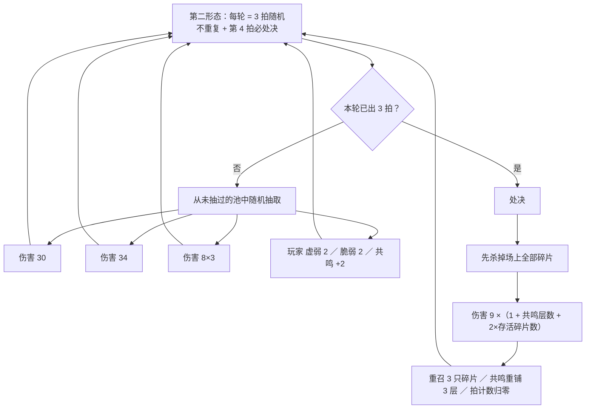

# CznMonster 四首领战斗流程图

> 口径：只写**实际效果与数值**，不写招式名。
> 数值取第 3 章基准（普通难度）；升华「致命敌人」伤害与「强敌」血量另见各设计文档 §2。
> 章节系数：美梦固定第 1 章、塞拉菲翁固定第 2 章、波勒米卡/阿涅丝固定第 3 章，实际出场值按各自 `*Scaling` 缩放。

---

## 1. 塞拉菲翁（双怪战：塞拉菲翁 240 HP + 阿克鲁斯 152 HP）

两条命绑在一起：阿克鲁斯活着时塞拉菲翁打不死，必须先处理阿克鲁斯。



前半场节奏：伤害 2×12 → 伤害 2×12 → 伤害 3×10 → 再回到伤害 2×12，如此循环。



正常守护节奏：+22 格挡/力量 +1 → 伤害 3×12 → 交替。



---

## 2. 波勒米卡（第 3 章，450 HP + 3 个召唤位）

核心是「行动 3 次必换防」：处决自己全部召唤物、按处决数量涨力量、重新召唤一批。



后半场（生命 <50% 之后的甲壳壁垒 + 精锐孵化起）：



召唤物各自的行动（只列效果，数值为第 3 章；召唤物进场当回合不行动）：

| 召唤物（生命） | 出场波次 | 行动与权重 |
| --- | --- | --- |
| 库勒提·兵（38） | 第一波 | 伤害 6 + 全体己方 力量 +1（60%，最多连 2 次）／ 伤害 6 + 玩家 易伤 1（40%，不连用） |
| 库勒提·盾（42） | 第一波 | 伤害 6（40%，最多连 1 次）／ 伤害 6 + 全体己方 +15 格挡（60%，最多连 2 次） |
| 岩壳虫（102） | 第二波 | 伤害 9 + 玩家 虚弱 2（55%）／ 自身 力量 +4 + 每名玩家把抽牌堆里稀有度最高 1 张牌塞进弃牌堆（20%，冷却 3）／ 伤害 9 + 自身 +15 格挡（25%，冷却 2） |
| 翼壳虫（96） | 第二波 | 伤害 9 + 玩家 脆弱 2（65%）／ 伤害 9 + 自身 +15 格挡（35%，不连用） |
| 壳虫（105） | 第二波 | 伤害 9 + 玩家 易伤 2（65%）／ 伤害 9 + 自身 +15 格挡（35%，不连用） |

---

## 3. 美梦（第 1 章，640 HP，单体双阶段）

被它打不计时，**打它才计时**：每次受击计数 -1，归零则全部被偷的牌回到手牌，它回满计数并涨力量。



受击计数规则：

```
玩家每打出一次命中（多段攻击按段计） → 计数 -1
计数归零 → 全部被偷的牌回手 → 下一拍必定是「回满计数 + 涨力量」
每回合玩家抽牌后 → 随机偷 1 张（阶段 1）／ 2 张（阶段 2）
```

---

## 4. 阿涅丝（第 3 章，640 HP，单实体双形态）

第一形态按固定 4 拍轮换；生命 <50% 后插一拍变身（判定实际发生在每拍开始，下图按轮末表示），第二形态每轮 3 个随机不重复行动 + 第 4 拍必处决。





处决伤害速查（基础 9）：

| 状况 | 共鸣 | 碎片 | 伤害 |
| --- | --- | --- | --- |
| 碎片一只不清、抽到蓄力拍 | 5 | 3 | 108 |
| 碎片一只不清 | 3 | 3 | 90 |
| 清 1 只、抽到蓄力拍 | 5 | 2 | 90 |
| 清 2 只、抽到蓄力拍 | 5 | 1 | 72 |
| 清 3 只、抽到蓄力拍 | 5 | 0 | 54 |
| 清 3 只 | 3 | 0 | 36 |

> 每清一只碎片 = 少挨 18 点；碎片只有 18 HP，且不会攻击（每拍只空过）。共鸣只增不减、上限 10。

---

## 5. 四首领共同点速查

| 首领 | 关键节奏 | 破局点 |
| --- | --- | --- |
| 塞拉菲翁 | 前半场每 3 拍一轮（2×12、2×12、3×10）；伴生每拍 +22 格挡或 3×12 | 先杀阿克鲁斯：否则塞拉菲翁打不死，且它会进入每拍 4×12 的终局前先补 45 格挡 |
| 波勒米卡 | 每 3 次行动必换防，换防按处决数给它涨力量 | 别让它靠召唤物堆力量；召唤物全灭也不会停手，只会反复重召 |
| 美梦 | 打它才降计数，计数归零就还牌 + 涨力量 | 多段攻击划算（既打伤害又加速赎回）；阶段 2 偷牌翻倍，要立刻打满 10 次 |
| 阿涅丝 | 第一形态 4 拍固定，第二形态 3 随机 + 1 处决 | 处决前清碎片，每只碎片等于 18 点减伤；碎片只有 18 HP |
